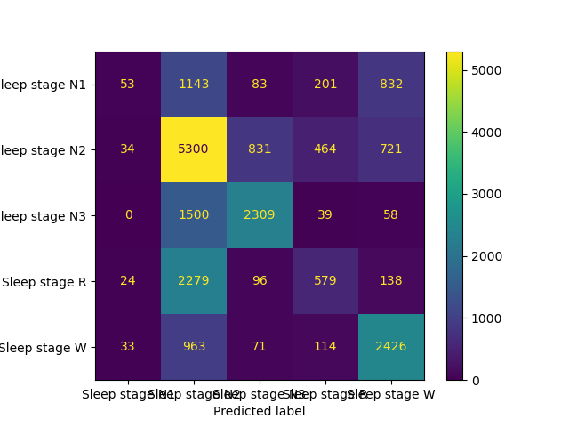
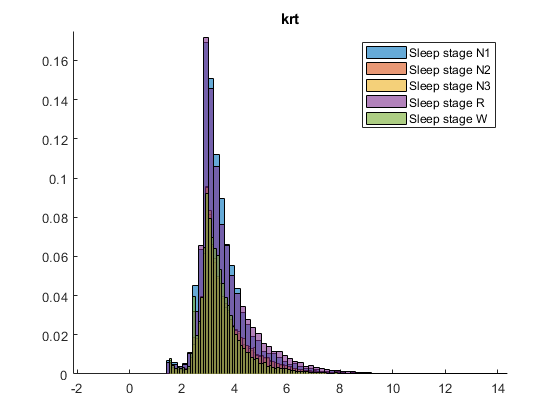

# Sleep Stage Classification with Higher-Order Statistics

Code for the semester project of the course **Advanced Signal Processing Techniques**
(Προηγμένες Τεχνικές Επεξεργασίας Σήματος, ECE AUTh, Spring 2023).

The project looks at whole-night polysomnographic (PSG) recordings. It tests whether
**higher-order statistics (HOS)** (the bispectrum, bicoherence, cepstrum and bicepstrum)
yield features that tell the five sleep stages apart (**W, N1, N2, N3, REM**).
These features then feed simple machine-learning classifiers (kNN, MLP).

📄 **Paper:** [`docs/Team1Project2023.pdf`](docs/Team1Project2023.pdf):
*Examine Sleep Stages Applying HOS Methods, Cepstral Analysis and Machine Learning Techniques*
(A. Tsiggilis, G. Papadimitriou).

---

## Dataset

[Haaglanden Medisch Centrum (HMC) Sleep Staging Database](https://physionet.org/content/hmc-sleep-staging/1.0.0/), PhysioNet:

- 151 whole-night PSGs (85 M / 66 F, mean age 53.9 ± 15.4)
- 8 channels sampled at 256 Hz: EEG F4/M1, C4/M1, O2/M1, C3/M2 · EOG E1/M2, E2/M2 · chin EMG · ECG
- Each 30 s epoch (7680 samples per channel) is scored by experts following AASM v2.4

The recordings are **not** part of this repository. Download them with:

```bash
wget -r -N -c -np https://physionet.org/files/hmc-sleep-staging/1.0.0/
```

This creates `physionet.org/files/hmc-sleep-staging/1.0.0/recordings/`, which is git-ignored.

> Alvarez-Estevez, D., & Rijsman, R. (2021). *Haaglanden Medisch Centrum sleep staging database* (v1.0.0). PhysioNet. https://doi.org/10.13026/gp48-ea60

## Method overview

```
 EDF recordings ──► 30 s epochs ──► HOS / cepstral estimation ──► statistical features ──► PCA ──► classifier
   (8 channels)                     • bicoherence (direct, K=32, fc=64 Hz)     mean, std, skewness,      (4 PCs)   kNN (k=16, Spearman)
                                    • bispectrum                               entropy, √entropy,                 MLP (scikit-learn)
                                    • cepstrum / bicepstrum                    #peaks, peak locations …
                                    • ARMA (cumulant-based)
```

1. **Cepstral analysis**: real and complex cepstrum plus minimum- and mixed-phase impulse-response estimates for each channel and stage. A periodic peak at quefrency ≈ 0.156 s appears in EOG E1/M2 and grows stronger in deeper sleep.
2. **Bicepstral analysis**: bicepstrum (FFT method) per epoch, summarised by variance, skewness, kurtosis and entropy. The EEG C4/M1 and O2/M1 entropy distributions differ between stages.
3. **Bicoherence**: direct-method estimate per patient, channel and epoch. Each bicoherence "frame" yields statistical features, and a peak-finding step yields peak-based features (number of peaks, mean peak value, mean peak coordinates). Quadratic phase coupling is also examined.
4. **Classification**: features are standardised and reduced with PCA to 4 components. A kNN classifier (k = 16, Spearman distance, 70/30 split) is evaluated with **Cohen's κ** because the classes are imbalanced (23.5k W, 15.4k N1, 49.3k N2, 26.4k N3, 21.0k R epochs). An MLP was also tried in Python.

**Outcome:** the features separate **W, N3 and REM** best. N1 and N2 get confused, and the overall agreement is modest. The main limitations named in the paper are that the models use no temporal context, the EOG and EMG features are weak, and the patients' pathologies are unknown. See Section IV of the paper for details.

<p align="center">
  
  
</p>

## Repository structure

```
.
├── matlab/
│   ├── setup_paths.m            # adds all MATLAB folders to the path
│   ├── io/                      # reading the HMC EDF files into MATLAB timetables
│   │   ├── loadEDF.m            #   load one patient (cached as .mat)
│   │   ├── read_data_of_patient.m
│   │   └── ReadEDF.m, SaveEDF.m #   generic EDF reader/writer (Shapkin, 2012)
│   ├── features/                # HOS & cepstral feature extraction
│   │   ├── bicEEG.m             #   bicoherence of EEG epochs (Nagashima normalisation)
│   │   ├── bicoherency.m        #   vectorised direct-method bicoherence
│   │   ├── Bicepstrum.m, avg_bicepstrum.m, bicepstrum_stats.m, bicepstrum_statistics_matrice.m
│   │   ├── avg_cepstrum1.m, stageceps.m          # cepstrum per stage
│   │   ├── avg_bic.m, arma_estimate.m, c3cum.m   # bicoherence / ARMA / 3rd-order cumulants
│   │   ├── findpeak.m, mom2.m, find_avg.m        # helpers
│   │   └── createImgDataset.m   #   export bicoherence frames as PNG images
│   ├── analysis/                # experiment scripts & plots
│   │   ├── demo_cepstrum.m, demo_cepstrum2.m, demo_bicepstrum.m,
│   │   │   demo_bicoherency.m, demo_arma.m
│   │   ├── makeHists.m          #   per-stage feature histograms
│   │   └── eogFeature.m, remPSphase.m, plotEOGPhases.m   # EOG / REM exploration
│   ├── classification/
│   │   └── knn.m                #   PCA + kNN classifier
│   └── third_party/             # HOSA toolbox (Swami, USS) and MathWorks rceps
├── python/
│   ├── dataloader.py            # EDF + hypnogram → epochs (pyedflib)
│   ├── hosa.py                  # JAX bispectrum / bicoherence
│   ├── estimateBIC.py           # batch bicoherence estimation → cache/*.pickle
│   └── mlp.py                   # PCA + MLP classifier (scikit-learn)
├── notebooks/
│   ├── balanced_mlp.ipynb       # class balancing (feats_eq.csv) and MLP experiments
│   └── neural_net.ipynb         # feature exploration
├── data/                        # pre-computed feature tables
│   ├── features.csv             # bicoherence features per epoch
│   ├── features_by_patient.csv  # same, with patient id
│   ├── feats_eq.csv             # class-balanced subset
│   ├── bicepstrum_f.csv         # bicepstrum statistics per epoch & channel
│   └── bicepstrum_statistics.mat
└── docs/
    ├── Team1Project2023.pdf     # project paper
    ├── assignment_description_el.pdf   # assignment (in Greek)
    └── figures/
```

## Getting started

### MATLAB

Requires the Signal Processing, Statistics and Machine Learning, and Image Processing toolboxes.

```matlab
run('matlab/setup_paths.m')

% load one patient as a timetable (one row per 30 s epoch)
Z = loadEDF(1);

% classify the pre-computed features
knn          % pick data/features.csv in the file dialog
makeHists    % per-stage histograms of the bicepstrum features
```

Most scripts in `matlab/analysis/` ask for the dataset folder with a dialog (`uigetdir`).

### Python

```bash
pip install numpy pandas scipy scikit-learn matplotlib pyedflib jax
```

Run the scripts from the repository root:

```bash
python python/estimateBIC.py
```

```bash
python python/mlp.py
```

`estimateBIC.py` reads the recordings from `./physionet.org/...` and writes one pickle per patient to `./cache/`. `mlp.py` trains on `data/features.csv`.

## Third-party code

- `matlab/third_party/hosa/`: functions from the **Higher-Order Spectral Analysis (HOSA) Toolbox**, © United Signals & Systems, Inc. (A. Swami).
- `matlab/third_party/rceps1.m`: a modified copy of MATLAB's `rceps`, © The MathWorks, Inc.
- `matlab/io/ReadEDF.m`, `SaveEDF.m`: EDF reader and writer by Shapkin Andrey (2012).

These files keep their original licences. Everything else is released into the public domain (see [`LICENSE`](LICENSE)).

## Authors

Team 1, ECE AUTh, 2023: Alexandros Tsiggilis, Georgios Papadimitriou, Christodoulos Michaelides, and Apostolos Soulios.
